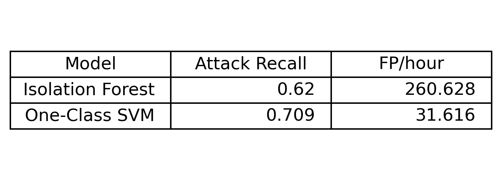

# ICS Anomaly Detection

## Description

Industrial Control Systems operate critical infrastructure such as water treatment plants, power grids, and manufacturing facilities. Because these systems typically follow predictable and deterministic patterns, abnormal behavior can often indicate system faults, sensor manipulation, or malicious activity.

This project implements an anomaly-based intrusion detection system (IDS) for industrial control systems using the Secure Water Treatment (SWaT) dataset. The goal is to detect cyber-attacks by modeling normal system behavior and identifying deviations in sensor and actuator data, simulating how attackers may affect ICS systems.

The detection pipeline includes feature engineering for sensor dynamics and actuator switching behavior, followed by anomaly detection using Isolation Forest and One-Class Support Vector Machine (SVM) models.

The models are evaluated using security-relevant metrics including attack detection rate and false positives per hour.

## Threat Model

The system assumes an attacker may manipulate sensor readings or actuator commands within an industrial control system. These manipulations may disrupt normal physical process behavior.

The Anomaly Detection System is designed to detect such attacks by identifying abnormal patterns in sensor measurements and actuator state transitions.

The attacker is assumed to:
- Have the ability to modify control signals or sensor data
- Attempt to remain stealthy by mimicking normal system behavior

The detection system operates as an anomaly detector trained only on normal system operation.

## Setup

### Requirements

Python 3.x with the following libraries:

- pandas
- numpy
- scikit-learn
- matplotlib
- seaborn

Install dependencies:

```bash
pip install -r requirements.txt
```
## How to Run

1. Clone the Repository
      ```bash
      git clone https://github.com/daniloebodden-gif/IDS-for-Industrial-Control-Systems.git
      cd IDS-for-Industrial-Control-Systems
      ```

2. Make sure the SWaT dataset files are in the dataset directory:
      dataset/
            normal.csv
            attack.csv

3. Run the notebook, executing all cells to reproduce the anomaly detection pipeline and evaluation results
      SWaT_IDS_pipeline.ipynb


## Results

Two anomaly detection models were evaluated at this time.



The One-Class SVM Model demonstrated improved attack detection performance with significantly fewer false positives compared to the Isolation Forest Model.

## Contributors

Danilo Bodden

## Repository Structure

```text
IDS-for-Industrial-Control-Systems
│
├── SWaT_IDS_pipeline.ipynb
├── dataset/
│ ├── normal.csv
│ └── attack.csv
├── images/
│ └── results_comparison.png
├── README.md
├── requirements.txt
├── anomaly_actuators.csv
└── anomaly_sensors.csv
